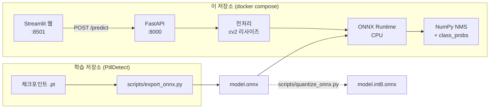

# 💊 PillDetect Serving — 알약 탐지 모델 서빙

[PillDetect](https://github.com/cjkj1234/beginner-project-pill)에서 학습한 YOLO11 알약 탐지 모델을 **ONNX로 변환해 FastAPI로 서빙**하고, **Streamlit 웹**으로 보여주는 프로젝트입니다. `docker compose up` 한 번으로 API와 웹이 함께 뜹니다.

코드잇 AI 엔지니어 부트캠프 4부(모델 배포·서빙)에서 배운 Docker, 모델 변환·양자화, Streamlit, FastAPI를 실제 프로젝트 모델에 적용했습니다.

> ⚠️ 연구·학습용 데모입니다. 실험실에서 촬영한 알약 사진으로 학습해서 일반 사진에서는 정확도가 낮습니다. 복약 판단이나 약 식별 같은 의료 목적으로 사용하지 마세요.

## 구조



| 구성 | 기술 | 위치 |
|---|---|---|
| 모델 변환 | PyTorch → ONNX (opset 17), ONNX Runtime 정적 INT8 양자화 | PillDetect `scripts/export_onnx.py`, [`scripts/quantize_onnx.py`](scripts/quantize_onnx.py) |
| API | FastAPI, pydantic 응답 스키마, ONNX Runtime | [`src/pill_serving/`](src/pill_serving) |
| 웹 | Streamlit (API만 호출) | [`web/streamlit_app.py`](web/streamlit_app.py) |
| 배포 | Docker 이미지 2개 + Compose, GitHub Actions에서 빌드·실행 검증 | [`Dockerfile.api`](Dockerfile.api), [`Dockerfile.web`](Dockerfile.web), [`docker-compose.yml`](docker-compose.yml) |

## 설계에서 신경 쓴 점

**1. 서빙 이미지에서 PyTorch를 뺐습니다.**
학습 저장소의 후처리(Ultralytics NMS + `class_probs`)를 NumPy로 옮겼습니다. API 이미지에는 ONNX Runtime, OpenCV(headless), NumPy만 들어갑니다.
옮긴 코드가 원래와 같은지는 Ultralytics 8.4.51의 `non_max_suppression`과 직접 비교하는 테스트 20개로 확인했습니다 ([`test_parity_ultralytics.py`](tests/test_parity_ultralytics.py)). 점수가 float32로 완전히 같은 박스끼리의 순서만 다를 수 있습니다 (NumPy 쪽은 앵커 번호 순으로 고정).

**2. 전처리를 학습과 똑같이 맞췄습니다.**
학습 때 Albumentations `Resize`가 쓴 `cv2.INTER_LINEAR`를 그대로 씁니다. PIL로 리사이즈하면 축소할 때 안티앨리어싱이 들어가서 픽셀 값이 달라집니다.
같은 이미지를 학습 저장소의 PyTorch 추론 경로와 이 서빙 경로로 각각 돌려 비교했습니다.

| 비교 | 차이 |
|---|---|
| ONNX vs PyTorch 모델 출력 | 박스 0.0007px, 점수 0.000003 |
| 서빙 결과 vs 학습 저장소 추론 결과 | 클래스·점수 동일, 박스 0.0002px |

서빙은 박스를 이미지 경계 안으로 자르지만, 학습 저장소는 자르지 않습니다. 그래서 박스 비교는 양쪽을 같은 방식으로 자른 뒤에 했습니다. 이 검증은 YOLO11s 구조와 학습되지 않은 가중치로 했고, 학습된 가중치로는 아직 하지 않았습니다.

**3. 모델이 없어도 서버는 뜹니다.**
`models/model.onnx`가 없거나 클래스 수가 맞지 않으면 `/health`가 `model_loaded: false`와 이유를 알려주고, `/predict`는 503을 돌려줍니다. 컨테이너가 계속 재시작되는 대신 원인을 바로 볼 수 있습니다.

**4. 웹과 API를 나눴습니다.**
웹 이미지는 API를 HTTP로 부르기만 해서 ONNX Runtime이 필요 없습니다 (`uv sync --only-group web`). 화면에는 박스와 번호만 그리고 약 이름은 표로 보여줘서, 한글 폰트가 없는 컨테이너에서도 글자가 깨지지 않습니다.

**5. 양자화는 측정해서 검증합니다.**
YOLO 출력은 박스 좌표(0~입력 크기)와 클래스 점수(0~1)를 한 텐서에 담습니다. 그래서 출력까지 양자화하면 점수가 망가질 수 있습니다. [`benchmark.py`](scripts/benchmark.py)는 크기와 지연시간뿐 아니라 FP32 모델 대비 **탐지 일치율**도 계산합니다. 더미 모델로 실험해 보니 출력까지 양자화했을 때 일치율이 33%로 떨어지는 게 이 표에서 바로 드러났습니다.

## 빠른 실행

### Docker Compose

```bash
uv sync
uv run python scripts/make_dummy_model.py --output models/model.onnx   # 실제 모델이 없을 때: 더미 모델
docker compose up --build
```

- API 문서: http://localhost:8000/docs
- 웹: http://localhost:8501

더미 모델은 입력과 상관없이 박스 3개를 내는 테스트용 모델입니다. 실제 모델을 넣는 방법은 아래에 있습니다.

### Docker 없이

```bash
uv sync
uv run uvicorn pill_serving.api:app --port 8000
```

```bash
uv run streamlit run web/streamlit_app.py
```

## 실제 모델 연결

학습 저장소([PillDetect](https://github.com/cjkj1234/beginner-project-pill))에서 학습하고 ONNX로 내보낸 뒤, `models/`에 넣습니다.

```bash
# PillDetect 저장소에서
python train.py --config configs/yolo11s_640_serving.yaml --run-name serving-11s-640
python scripts/export_onnx.py --config configs/yolo11s_640_serving.yaml \
    --checkpoint outputs/checkpoints/best_model.pt --use-ema --output outputs/export/model.onnx
```

`outputs/export/`에 생긴 `model.onnx`와 `class_mapping.json`을 이 저장소의 `models/`에 복사하면 됩니다. 입력 크기와 클래스 수는 ONNX 파일에서 자동으로 읽습니다.

서빙 데모에는 CPU에서 빠른 **YOLO11s · 640px**를 기본으로 잡았습니다. 대회 최고 단일 모델(YOLO11x · 1024px)도 같은 방법으로 내보낼 수 있지만 CPU에서는 훨씬 느립니다.

## API

| 메서드 | 경로 | 설명 |
|---|---|---|
| GET | `/health` | 서버 상태와 모델 로드 여부 |
| GET | `/model` | 모델 파일, 입력 크기, 클래스 수, 후처리 설정 |
| POST | `/predict` | 이미지(multipart `file`) → 탐지 결과 |

```bash
curl -F "file=@pill.png" http://localhost:8000/predict
```

<details>
<summary>응답 예시 (더미 모델)</summary>

```json
{
  "image": { "width": 976, "height": 1280 },
  "detections": [
    {
      "box": { "x1": 61.0, "y1": 80.0, "x2": 91.5, "y2": 120.0 },
      "score": 0.90,
      "class_id": 0,
      "category_id": 1900,
      "name": "보령부스파정 5mg",
      "candidates": [
        { "class_id": 0, "category_id": 1900, "name": "보령부스파정 5mg", "prob": 0.855 },
        { "class_id": 1, "category_id": 2483, "name": "뮤테란캡슐 100mg", "prob": 0.047 },
        { "class_id": 2, "category_id": 3351, "name": "일양하이트린정 2mg", "prob": 0.047 }
      ]
    }
  ],
  "timing": { "preprocess_ms": 13.1, "inference_ms": 0.6, "postprocess_ms": 0.5, "total_ms": 14.2 },
  "disclaimer": "연구·학습용 데모입니다. ..."
}
```

</details>

- `candidates`는 박스가 나온 앵커의 클래스 점수를 합이 1이 되게 정규화한 값입니다. 학습 저장소에서 WBF 앙상블 투표에 쓰는 `class_probs`와 같습니다.
- 설정은 환경 변수로 바꿉니다: `MODEL_PATH`, `CLASS_MAPPING_PATH`, `CONF_THRESHOLD`(0.25), `IOU_THRESHOLD`(0.7), `MAX_DETECTIONS`(4), `CLASS_AGNOSTIC_NMS`(true), `MAX_UPLOAD_MB`(10).

## 양자화와 벤치마크

```bash
# 보정용 이미지(학습 이미지 50~100장)로 INT8 정적 양자화
uv run python scripts/quantize_onnx.py --input models/model.onnx \
    --output models/model.int8.onnx --calibration-dir data/calib

# 크기 · CPU 지연시간 · FP32 대비 탐지 일치율
uv run python scripts/benchmark.py models/model.onnx models/model.int8.onnx --images data/calib
```

실제 가중치로 잰 결과는 학습을 마친 뒤 이 자리에 표로 추가합니다. 정확한 mAP는 정답 라벨이 필요해서 학습 저장소의 평가 코드로 따로 잽니다.

## 테스트

```bash
uv run pytest
```

- 후처리, 전처리, ONNX 추론기, API, 웹 화면 테스트 25개가 있습니다. 더미 ONNX 모델을 테스트 안에서 만들어서 가중치 없이 돕니다.
- Ultralytics와의 동등성 테스트는 PyTorch가 필요해서 따로 실행합니다. Ultralytics를 import하면 Pillow의 `Image.open`이 바뀌므로 다른 테스트와 같은 프로세스에서 돌리지 않습니다.

```bash
uv run --with torch --with torchvision --with ultralytics==8.4.51 pytest tests/test_parity_ultralytics.py
```

GitHub Actions는 테스트를 돌린 뒤 Docker 이미지 두 개를 빌드하고, 더미 모델로 컨테이너를 띄워 `/health`, `/predict`, 웹 헬스체크까지 실제 HTTP로 확인합니다.

## 한계

- 학습 데이터가 실험실 촬영 이미지라 휴대폰 사진에서는 정확도가 크게 떨어질 것입니다.
- 학습 데이터(부트캠프 Kaggle 대회, AI Hub 경구약제 이미지)는 이용 조건 때문에 포함하지 않았습니다. 학습한 가중치도 공개 범위를 확인한 뒤 올립니다.
- 학습된 가중치로 측정한 지연시간·정확도는 아직 없습니다.

## 다음 단계

- [ ] YOLO11s · 640px로 학습하고 FP32 / INT8 벤치마크 표 추가
- [ ] Hugging Face Spaces(Docker)에 공개 데모 배포
- [ ] Triton Inference Server와 처리량 비교

## 저장소 구조

```
├── src/pill_serving/
│   ├── api.py           # FastAPI 앱 (/health, /model, /predict)
│   ├── detector.py      # ONNX Runtime 세션 + 전처리·후처리·좌표 복원
│   ├── preprocess.py    # 이미지 디코딩(EXIF 회전), 학습과 같은 리사이즈
│   ├── postprocess.py   # NumPy NMS + class_probs (Ultralytics와 동등)
│   ├── classes.py       # 클래스 매핑 로드
│   ├── schemas.py       # 응답 스키마 (pydantic)
│   ├── config.py        # 환경 변수 설정
│   └── dummy.py         # 개발·테스트용 더미 ONNX 생성
├── web/streamlit_app.py # 데모 웹
├── scripts/             # 더미 모델 생성, INT8 양자화, 벤치마크
├── models/              # class_mapping.json (모델 파일은 저장소에 올리지 않음)
├── tests/
├── Dockerfile.api · Dockerfile.web · docker-compose.yml
└── .github/workflows/ci.yml
```
